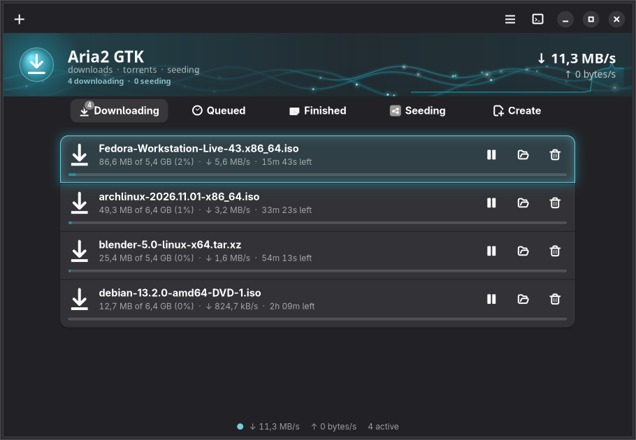
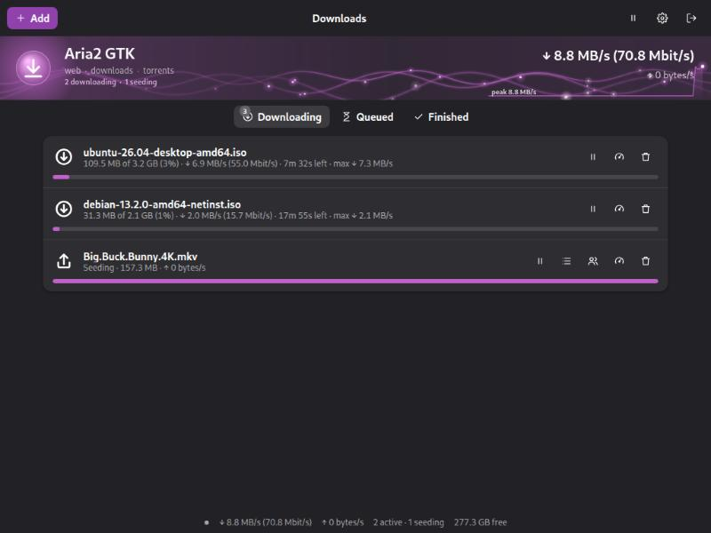

# aria2-gtkGUI

A download manager for Linux built on [aria2](https://aria2.github.io/), written in Python with GTK4 and libadwaita. The whole app is a single file, `aria2gtk.py`.



It starts its own private aria2c (JSON-RPC on a random localhost port, with a random secret) and controls it over RPC. Unfinished downloads are saved in a session file and resume the next time the app starts.

## Features

- **Downloads:** HTTP(S), FTP, Metalink, `.torrent` files and magnet links, in tabs for Downloading, Queued and Finished.
- **File choice:** pick which files of a torrent or magnet to download before it starts.
- **Seeding:** keep finished torrents seeding, seed existing folders, and create new torrents with `mktorrent`.
- **Peers window:** clients, speeds, progress and country flags. Flags come from a local database (DB-IP Country Lite), so no peer IP addresses leave your PC.
- **Console panel:** a dockable live view of aria2's log, colour-coded by level.
- **Preferences:** the important aria2 options, plus a Storage page that shows large log files and empties them, and automatic updates for the country database.
- **Desktop integration:** tray icon (StatusNotifierItem), handler for torrent files and magnet links, an animated header banner, adjustable window transparency (blurred by KDE's Better Blur).

## Requirements

On Arch-based distributions:

```bash
sudo pacman -S --needed aria2 python-gobject python-cairo gtk4 libadwaita mktorrent
```

GTK 4.16+ and libadwaita 1.6+ are needed. `mktorrent` is only needed for creating torrents.

## Running

```bash
./aria2gtk.py
```

`--hidden` starts it in the tray. Files or magnet links given on the command line are added.

To open `.torrent` files and magnet links with it, copy `io.github.aria2gtk.desktop` to `~/.local/share/applications/`. Edit its `Exec=` line to the full path of `aria2gtk.py`, then run:

```bash
update-desktop-database ~/.local/share/applications
```

## Web UI

**In the desktop app:** Preferences → **Web UI** → *Enable Web UI*. While the app runs, its
downloads can be watched and controlled from a browser on any PC, phone or tablet in your
network. The first time, it shows a generated password (you can set your own there). The page
is served from the app's own aria2c, so it is the same list as in the window.

## Web UI for a home server (Proxmox, NAS, …)

The same `aria2gtk.py` runs on a server without a desktop: when it finds no graphical display
(an LXC, SSH, a systemd service) or no GTK installed, it starts the web UI server instead of the
window, and says why. `--headless` forces this mode on a desktop too. It then needs only `aria2`
and `python3`, so a small Debian LXC is enough. (The server code lives in `aria2gtk-server.py`,
which must stay next to `aria2gtk.py`.)



The page has the same banner, tabs and rows as the desktop app. It can:
- add links, magnets, `.torrent` and `.metalink` files, by pasting, drag-and-drop or file picker;
- choose which files of a torrent to download;
- set speed limits per download (right-click, or long-press on a phone);
- show peers with country flags, and the free space on the server;
- **Seeding** tab: seed your own torrents (upload the `.torrent`, pick the folder that holds
  the data), each with its own upload limit; seeds start again after a restart;
- **Create** tab: make a `.torrent` from a folder or file on the server (with your tracker,
  or DHT only, public or private), download it or copy its magnet, and start seeding it.
  This is built in, so the server doesn't need `mktorrent`.

When the web UI runs inside the desktop app, these two tabs use the app's own Seeding list.

**Security:**
- **Password sign-in:** passwords are stored as a PBKDF2 hash, and sign-ins last 30 days.
- **aria2 stays private:** it listens on localhost only, and the page never sees its secret.
- **Limited access:** only download actions are allowed, and folders must be inside the
  download folder.
- **Encryption:** plain http is fine on a home network. Use `--cert`/`--key` (or a reverse
  proxy) if it's reachable from the internet.

### Quick start in a Proxmox LXC (Debian 12/13 template)

```bash
apt install aria2 python3 git
git clone https://github.com/iceM0nger/aria2-gtkGUI /opt/aria2gtk
useradd --system --home-dir /var/lib/aria2gtk-server --shell /usr/sbin/nologin aria2
mkdir -p /srv/downloads && chown aria2:aria2 /srv/downloads
cp /opt/aria2gtk/aria2gtk-server.service /etc/systemd/system/
systemctl daemon-reload && systemctl enable --now aria2gtk-server
journalctl -u aria2gtk-server | grep password      # the first-start password
```

Then open `http://<container-ip>:6880/` and sign in. To change the password, use the page's
Settings, or run `aria2gtk.py --headless --set-password --data /var/lib/aria2gtk-server` as the
`aria2` user.

**Tips:**
- **Storage:** mount a disk or NAS share into the LXC (`pct set <id> -mp0 /tank/downloads,mp=/srv/downloads`)
  so downloads land on your storage.
- **Port forwarding:** for torrents, forward TCP and UDP port 51413 (`--bt-port`) to the container on your router.

Options: `--port` (6880), `--bind` (all interfaces), `--dir`, `--data`, `--bt-port`, `--cert`/`--key`.
Try it on any Linux PC: `./aria2gtk.py --headless --dir ~/Downloads`.

## Where things are kept

`~/.local/share/aria2gtk/` holds:
- `settings.json`
- `session`: unfinished downloads
- `aria2.log`: trimmed automatically above 100 MB
- `torrents/`: copies of added torrents
- the country database

Your own `~/.aria2/aria2.conf` is read too. Options you set in Preferences take priority over it.

## Credits

IP geolocation by [DB-IP](https://db-ip.com), licensed under CC BY 4.0.

## License

GPL-3.0. See [LICENSE](LICENSE).
